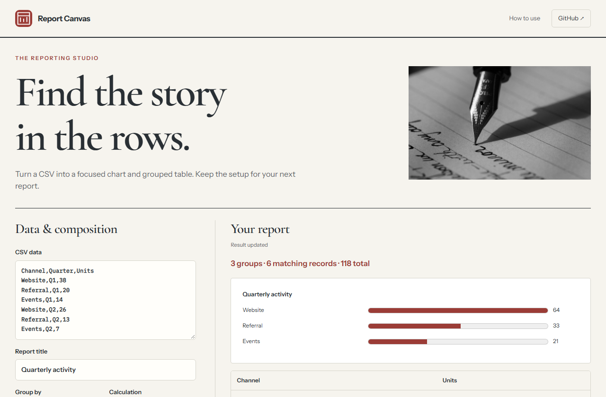

# Report Canvas

**Build a chart from CSV.** Group and filter records, compare totals, and save a reusable report setup. The browser processes your file locally.

[Open the live tool](https://musabukhari237.github.io/report-canvas/) · [Report an issue](https://github.com/MusaBukhari237/report-canvas/issues)

[](https://musabukhari237.github.io/report-canvas/)

## Try the example

Load the example. Filter to Q1 and change sum to count. Save the setup JSON, then apply it to another CSV with matching column names.

## Data and limits

Supports up to 25,000 comma-separated records, 80 columns and 30 displayed groups. Group labels reuse the CSV values. The sum uses JavaScript floating point. A saved setup includes report settings such as the title and filter value, and omits CSV rows. Keep private filters out of shared setup files.

Column names must be unique. The report displays the largest groups by value while keeping the total across all matching groups. CSV exports protect strings that spreadsheets might interpret as formulas.

## Run locally

Clone the repo and serve the `docs` folder from localhost.

```sh
python -m http.server 8000 --bind 127.0.0.1 --directory docs
```

Open http://127.0.0.1:8000 in a current browser. Run `node --test` from the repository root with Node.js 22 or later.

## Interface

Serif typography, a monochrome notebook photograph, a narrow composition panel, and a wide chart area create an editorial report workspace.

Use Ctrl+Enter or Command+Enter to run the current inputs. Clear editor clears pasted text, and View results moves keyboard focus to the output. Status text identifies changed inputs and refreshed results.

Fonts and imagery are bundled locally. Visual sources and font licenses are recorded in [asset credits](docs/Assets.md).

## Sponsors

Supported by [LeadCeleris](https://www.leadceleris.com/) and [AIFFICIENTO](https://www.aifficiento.biz/).

## Contributing

Read [CONTRIBUTING.md](CONTRIBUTING.md) and use synthetic fixtures in issue reports. The source is available under the [MIT license](LICENSE).
